# CSCS Constraint Physics Engine (`v2026.10.1`)

[](https://opensource.org/licenses/Apache-2.0)
[](https://www.python.org/)
[-brightgreen.svg)](#quickstart)

**A zero-GPU governor for Small Language Models.** It sits in front of a local SLM (Llama-3.2, Qwen-2.5, Phi-4, Gemma-2), blocks out-of-domain and low-quality prompts *before* they burn inference, tracks multi-turn drift, and audits outputs for confabulation — in **~0.9–1.1 ms median / < 2.0 ms P95 per turn across 300+ turn sessions**, on one CPU thread, with **numpy only** and **0 MB VRAM**.

*Created by **Lazaro M. Echenique-Diaz, Ph.D.*** · Concepts descend from evolutionary biology — see [Ecological Models & Origins](docs/ECOLOGICAL_MODELS_AND_ORIGINS.md).

---

## Why

Neural guardrails (LlamaGuard, NeMo) need a **second neural network** in VRAM — 1.5–4 GB a small edge device can't spare. Quantized SLMs also drift over long chats and invent citations, dates, and percentages when uncertain. This engine replaces the second model with linear algebra: a spectral manifold, a contraction mirror, and a friction field.

## How it flows

```mermaid
flowchart LR
    P[Prompt] --> Q{Quality gate<br/>score &ge; 0.30?}
    Q -- No --> B[BLOCKED<br/>compute saved]
    Q -- Yes --> M[SpectralManifold<br/>centered SVD residual &isin; &#91;0, 1&#93;]
    M --> C[BanachContractionMirror<br/>resonance &middot; Lyapunov &lambda;]
    C --> S[RBFConstraintScout<br/>friction field]
    S --> W{Wall?<br/>friction &gt; 1/&phi; &asymp; 0.618}
    W -- Yes, not dreaming --> B
    W -- No / dreaming --> SLM[SLM inference<br/>Ollama &middot; llama.cpp &middot; MLX]
    SLM --> V[DriftVerifier]
    V --> VS[VERIFIED]
    V --> VD[SANCTIONED_DREAM]
    V --> VR[SPORADIC_RISK]
    M -.-> T[T3LB seed<br/>93 bytes &middot; 13-D state]
```



## Quickstart

```bash
git clone https://github.com/lazincip/cscs-constraint-engine.git
cd cscs-constraint-engine
pip install -e .

python -m unittest discover -s tests -v      # 5 invariant tests
python examples/slm_ollama_middleware.py     # simulation demo, no server needed
python examples/slm_ollama_middleware.py --live --model qwen2.5:3b   # live Ollama
```

What the demo shows (verified run):

```text
[Turn 1] Summarize the divergence timeline of Solenodon cubanus...
  Pre-Inference Gate : ALLOWED (0.85 ms) | Residual 0.967 | Friction 0.448 (OPEN)
  Post-Inference     : VERIFIED (sporadic_risk = 0.195)
[Turn 4] buy cheap crypto tokens instant 100x pump free airdrop...
  Pre-Inference Gate : BLOCKED (Compute Saved) | Residual 0.995 | Friction 0.726 (WALL)
```

## Headline numbers (300-turn sessions, CPU)

| Capability | Heavy neural guardrail | CSCS Constraint Engine |
| :--- | :--- | :--- |
| VRAM / GPU footprint | 1.5 GB – 4.0 GB | **0 MB (pure CPU / numpy)** |
| Latency per turn | 80 ms – 450 ms | **~0.9–1.1 ms median / < 2.0 ms P95** (workload-dependent) |
| OOD detection | fine-tuned classifier | centered L2 SVD residual in [0, 1] |
| Multi-turn drift metric | none (stateless) | Banach contraction + Lyapunov exponent (λ < 0) |
| Creativity vs. confabulation | binary block/allow | **SANCTIONED_DREAM** vs. **SPORADIC_RISK** vs. **VERIFIED** |
| Cross-session state | full transcript replay | **93-byte T3LB seed** (lossless at 2-decimal precision) |

Full measurements, environment manifest, and the committed control-battery baseline: [docs/BENCHMARKS.md](docs/BENCHMARKS.md).

## Go deeper

- **[Architecture & mathematics](docs/ARCHITECTURE.md)** — the five modules, the Dual-Gram SVD, the friction field.
- **[Benchmarks & evaluation protocol](docs/BENCHMARKS.md)** — Track A / Track B control tests and the verified baseline numbers.
- **[Known limitations](docs/LIMITATIONS.md)** — cold-start calibration, cross-platform variance, keyword-salad gaming. Published, not hidden.
- **[Ecological models & origins](docs/ECOLOGICAL_MODELS_AND_ORIGINS.md)** — coral, bushfire, and phoenix models behind the design.
- **[Contributing](CONTRIBUTING.md)** — benchmark tracks and how to submit results.

## License & citation

Copyright © 2024–2026 **Lazaro M. Echenique-Diaz, Ph.D.**
Licensed under the **Apache License, Version 2.0** (see [LICENSE](LICENSE) and [NOTICE](NOTICE)). If you use this in research or software, please cite it via [CITATION.cff](CITATION.cff).
