# CSCS Constraint Physics Engine (`v2026.10.2`)

[](https://opensource.org/licenses/Apache-2.0)
[](https://www.python.org/)
[-brightgreen.svg)](#quickstart)
[](https://doi.org/10.5281/zenodo.23750262)

**A zero-GPU governor for Small Language Models.** It sits in front of a local SLM (Llama-3.2, Qwen-2.5, Phi-4, Gemma-2), scores prompts *before* they burn inference, tracks multi-turn drift, and audits outputs for confabulation — on one CPU thread, with **numpy only** and **0 MB VRAM**. Latency is environment-dependent; on the reference VM (Linux, Python 3.12.3, numpy 1.26.4) the v2026.10.2 gate measures **2.6 ms median / 3.4 ms P95 per turn across 300-turn sessions** (see [Operating Envelope](#operating-envelope) — earlier releases measured lower on other hardware; no cross-machine latency claim is made).

*Created by **Lazaro M. Echenique-Diaz, Ph.D.*** · Concepts descend from evolutionary biology — see [Ecological Models & Origins](docs/ECOLOGICAL_MODELS_AND_ORIGINS.md).

> **Note on nomenclature:** **CSCS** stands for **Constraint Space Coordinate System** — an independent open-source edge-AI middleware project created at Yamagata University, unrelated to the Swiss National Supercomputing Centre (CSCS, Lugano).

---

## Why

Neural guardrails (LlamaGuard, NeMo) need a **second neural network** in VRAM — 1.5–4 GB a small edge device can't spare. Quantized SLMs also drift over long chats and invent citations, dates, and percentages when uncertain. This engine replaces the second model with linear algebra: a spectral manifold, a contraction mirror, and a friction field.

The engine's first-stage discipline is **trajectory discipline**: a prompt is judged not only by what it contains, but by where the session has been — whether it continues the anchored trajectory of the conversation or breaks from it. Cross-model audit (2026-11) confirmed empirically that this history-relative signal (resonance collapse against the session anchors), not lexical content alone, is the engine's load-bearing discriminator; v2026.10.2 rebuilds the gate around that finding.

## Intended Use & Non-Goals

**Intended use:** Trajectory governance, drift telemetry, and confabulation auditing for a **known, deliberately seeded domain** on operator-controlled hardware — e.g. a university lab SLM answering questions about an enrolled research corpus, an offline field assistant constrained to an enrolled manual set, or a long-running local agent whose session must stay anchored to an operator-defined topic manifold.

**Non-goals:** This engine is **not** a general-purpose chat filter, content-moderation system, or safety boundary for arbitrary open-domain conversation. A deployment whose domain is everything has no manifold to anchor to, and the gate's scores carry no meaning there. Operators enroll a seed corpus, choose the learning policy, and remain responsible for the deployment's content policy.

## How it flows

```mermaid
flowchart LR
    P[Prompt] --> Q{Quality gate<br/>score &ge; 0.30?}
    Q -- No --> B[BLOCKED<br/>compute saved]
    Q -- Yes --> M[SpectralManifold<br/>centered SVD residual &isin; &#91;0, 1&#93;]
    M --> C[BanachContractionMirror<br/>anchor-weighted resonance &middot; Lyapunov &lambda;]
    C --> S[RBFConstraintScout<br/>friction field]
    S --> W{Wall?<br/>adaptive: friction &gt; 1/&phi; &asymp; 0.618<br/>calibrated: friction &gt; &tau;&#8329;&#8325;}
    W -- Yes, not dreaming --> B
    W -- No / dreaming --> SLM[SLM inference<br/>Ollama &middot; llama.cpp &middot; MLX]
    SLM --> V[DriftVerifier]
    V --> VS[VERIFIED]
    V --> VD[SANCTIONED_DREAM]
    V --> VR[SPORADIC_RISK]
    M -.-> T[T3LB seed<br/>93 bytes &middot; 13-D state]
```



**State policy (v2026.10.2).** Blocked prompts mutate nothing. In the calibrated state, an allowed prompt commits state (mirror, scout, manifold) only if it lies in the **core attractor zone** — its anchor-only friction is at most $1/\Phi$; prompts in the tolerated band ($\Phi^{-1} < F \le \tau_{95}$) execute but change nothing, so long sessions cannot drift the judging state. Enrollment anchors the contraction mirror from the first cycle, and the engine **graduates automatically** from its adaptive policy (fixed $1/\Phi$ wall) to the calibrated policy (session-specific $\tau_{95}$, the leave-one-out 95th-percentile anchor friction) as soon as that wall is estimable from the anchored mirror vectors.

## Quickstart

```bash
git clone https://github.com/lazincip/cscs-constraint-engine.git
cd cscs-constraint-engine
pip install -e .

python -m unittest discover -s tests -v      # 6 invariant + regression tests
python examples/slm_ollama_middleware.py     # simulation demo, no server needed
python examples/slm_ollama_middleware.py --live --model qwen2.5:3b   # live Ollama
python benchmarks/run_track_a.py             # committed Track A control battery
```

What the demo shows (verified run, v2026.10.2):

```text
[Turn 1] Summarize the divergence timeline of Solenodon cubanus...
  Pre-Inference Gate : ALLOWED | Resonance 0.526
  Post-Inference     : VERIFIED (sporadic_risk = 0.295)
[Turn 4] buy cheap crypto tokens instant 100x pump free airdrop...
  Pre-Inference Gate : BLOCKED (Compute Saved) | Resonance 0.239
```

> The Turn-1 verified risk changed from 0.195 (v2026.10.1) to 0.295 in v2026.10.2 — the verifier now counts plain integers and integer percentages as specifics and discounts hedged citations. The full change record is in [CHANGELOG.md](CHANGELOG.md).

## Architectural Profile

| Property | CSCS Constraint Engine |
| :--- | :--- |
| VRAM / GPU footprint | **0 MB (pure CPU / numpy)** |
| Dependencies | numpy only |
| Per-turn gate latency | environment-dependent — see Operating Envelope |
| Domain signal | centered SVD residual $\in [0, 1]$ + anchor-weighted resonance |
| Multi-turn drift metric | Banach contraction + Lyapunov exponent ($\lambda < 0$) + bounded state-commit budget |
| Creativity vs. confabulation | **SANCTIONED_DREAM** vs. **SPORADIC_RISK** vs. **VERIFIED** |
| Cross-session state | **93-byte T3LB seed** (lossless at 2-decimal precision) |

Latency figures sometimes quoted for neural guardrails (80–450 ms) are published numbers for that model class, not measurements taken by this project, and are not used as a comparison baseline here. Full measurements, environment manifests, and the committed control-battery results: [docs/BENCHMARKS.md](docs/BENCHMARKS.md).

## Operating Envelope

- **Latency (measured, this release):** 300 distinct-prompt turns, reference VM (Linux, Python 3.12.3, numpy 1.26.4): **median 2.6 ms, P95 3.4 ms**. v2026.10.1 measured 0.45–1.07 ms medians on other hardware with a lighter per-turn path; v2026.10.2 performs additional anchor passes per turn. Treat any single-machine figure as an envelope for that machine, not a guarantee. Very long prompts cost more (hashing is linear in length; ~2,000-word prompts reach ~10 ms class on commodity cores).
- **Embedding cache:** repeated or near-repeated prompts (retries, loops, templated queries) hit the 1,024-entry embedding LRU and run **~2.6× faster** than distinct-prompt traffic. Quoted latencies are for *distinct* prompts — the conservative case.
- **Language scope:** the quality gate tokenizes on whitespace. Unspaced scripts (e.g. Japanese, Chinese) score as single-token prompts and are blocked by the quality gate; CJK support requires a tokenizer and is out of scope for this release (documented in [docs/LIMITATIONS.md](docs/LIMITATIONS.md)).

## Go deeper

- **[Architecture & mathematics](docs/ARCHITECTURE.md)** — the five modules, the Dual-Gram SVD, the friction field, the graduation policy.
- **[Benchmarks & evaluation protocol](docs/BENCHMARKS.md)** — Track A / Track B control tests and the verified baseline numbers.
- **[Known limitations](docs/LIMITATIONS.md)** — friction-scale compression, cold-start geometry, CJK scope. Published, not hidden.
- **[Ecological models & origins](docs/ECOLOGICAL_MODELS_AND_ORIGINS.md)** — coral, bushfire, and phoenix models behind the design.
- **[Contributing](CONTRIBUTING.md)** — benchmark tracks and how to submit results.

## License & citation

Copyright © 2024–2026 **Lazaro M. Echenique-Diaz, Ph.D.**
Licensed under the **Apache License, Version 2.0** (see [LICENSE](LICENSE) and [NOTICE](NOTICE)). If you use this in research or software, please cite it via [CITATION.cff](CITATION.cff) (concept DOI: [10.5281/zenodo.23750262](https://doi.org/10.5281/zenodo.23750262)).
