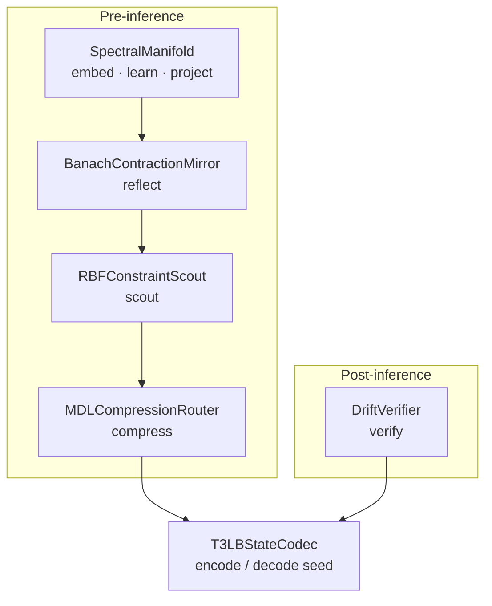

# Mathematical Architecture

Five modules, one pipeline. All computation is CPU linear algebra (`numpy` only).



### 1. `SpectralManifold` (Feature Hashing + Sign-Canonicalized Dual-Gram SVD)
Maps prompts into $\mathbb{R}^{512}$ via signed 32-bit `Blake2b` projections of character 3-grams and word unigrams (with token and prompt LRU caching). Over a sliding trajectory window ($W = 20$, refit every turn for $N \le 10$ and novelty-gated at $\text{residual} > 0.30$ every 10 turns thereafter), it computes the exact **Dual-Gram Singular Value Decomposition** ($G = X_c X_c^T$, recovering $V_k = \Sigma_k^{-1} U_k^T X_c$), extracting the top $k$ orthonormal principal axes $V_k \in \mathbb{R}^{k \times 512}$ with deterministic sign canonicalization ($\max_j |V_k[i, j]| > 0$).
* **Normalized Centered Residual:** Measures exact orthogonal projection loss on the centered vector $v_c = v - \mu$:
  $$\text{reconstruction\_error} = \frac{\|v_c - P_{V_k}(v_c)\|_2}{\|v_c\|_2 + \varepsilon} \in [0.0, 1.0]$$
* **Effective Dimensionality:** Computes the exponential Shannon entropy of the normalized singular value spectrum $e^{H(\sigma^2)}$.

### 2. `BanachContractionMirror` (Fixed-Point Context Alignment)
Models conversational intent alignment as an iterated dynamical system on the unit hypersphere $S^{F-1}$:
$$x_{t+1} = \text{normalize}\Big((1 - L_t) x_t + L_t A(x_t, C)\Big), \quad L_t = \Phi^{-t}$$
where $A(x_t, C)$ is the Boltzmann softmax barycenter over historical memory vectors $C$ ($\text{maxlen} = 32$) and $\Phi = \frac{1+\sqrt{5}}{2}$. Tracks step displacements to compute the **empirical Lyapunov exponent** ($\lambda < 0$), confirming whether the dialogue is converging toward a stable attractor.

Since v2026.10.2 the mirror holds **pinned enrollment anchors** alongside session memory, and its fixed-point similarity is **anchor-weighted**: $\text{fp\_sim} = 0.70 \times$ (final step size against the anchor barycenter) $+\ 0.30 \times$ (final step size against the session trajectory). Enrollment synchronizes mirror anchors with manifold anchors from the first cycle, so resonance measures distance to the *enrolled domain*, not to an empty memory — this removes the cold-start synthetic resonance (identically 1.0) of earlier releases and the presentation-order dependence it caused. An `anchors_only` reflection mode scores a prompt against the pinned anchors alone and drives the engine's commit budget (§6).

### 3. `RBFConstraintScout` (Continuous Friction Field)
Applies a **Radial Basis Function (Gaussian Kernel Density) Estimator** over the $k$-dimensional spectral coordinates ($\text{maxlen} = 64$ nodes). Local friction combines prompt quality deficit, centered manifold reconstruction residual, and attractor alignment deficit:
$$F = 0.30\,(1 - q) + 0.45 \cdot \text{clip}\!\left(\frac{r - 0.30}{0.70}, 0, 1\right) + 0.25\,(1 - \text{resonance})$$
blended toward the KDE of past node frictions once enough nodes accumulate. The **wall** depends on the engine's policy state (§6): $F > \Phi^{-1} \approx 0.618$ in the adaptive state; $F > \tau_{95}$ in the calibrated state.

### 4. `DriftVerifier` (Sanctioned Dream vs. Sporadic Risk Router)
Audits post-inference SLM outputs without external RAG by combining semantic drift ($1 - \cos(v_{\text{prompt}}, v_{\text{output}})$), assertive-to-hedging lexical ratios, and unsolicited specificity density (named entities, years, floating-point percentages):
* `SANCTIONED_DREAM`: High novelty explicitly invited when `dreaming=True`.
* `VERIFIED`: Grounded response consistent with prompt manifold.
* `SPORADIC_RISK`: High-specificity confabulation detected when `dreaming=False`.

### 5. `T3LBStateCodec` (13-Dimensional State Seed)
Serializes 13 operational constraint parameters ($X, Y, Z, W, P, T, R, S, V, N, E, B, Q$) into a compact 93-byte string (lossless at 2-decimal fixed precision):
```text
T3LB:v2026.10|M4.11|X0.88Y1.25Z0.76W1.01P0.87T0.79R0.79S0.92V0.78N0.74E0.88B0.79Q0.93|SecLock
```
Since v2026.10.2 **all 13 dimensions update from live engine telemetry every cycle** (earlier releases held 7 of the 13 constant). `decode()` parses a seed back into its dimensions; reconstructing a live engine state from a seed is not implemented (see [LIMITATIONS.md](LIMITATIONS.md)).

### 6. Engine Policy: Hybrid Graduation & Commit Budget (`CSCSMiddlewareEngine`)
Enrollment and gating follow a two-state policy:

* **Anchored enrollment.** `SpectralManifold.learn()` enrolls seed vectors as *anchors*; the engine synchronizes the same vectors into the contraction mirror (`add_anchor`, capped at $N_\Phi = 10$), so both modules judge against the enrolled domain from cycle 1.
* **Adaptive state.** Until graduation, the wall is the fixed $1/\Phi \approx 0.618$ and high-quality early prompts may enroll as anchors (cold-start accumulation, quality $\ge 0.70$, up to 4 anchors).
* **Automatic graduation.** After each enrollment the engine attempts a leave-one-out calibration over the anchor vectors: for each anchor it refits the subspace and mirror *without* that anchor and measures the friction the held-out anchor would face. Once $\ge 4$ anchor frictions exist, the 95th percentile becomes the session wall $\tau_{95}$ and the engine switches to the **calibrated** state. (On the reference battery, $\tau_{95} = 0.6566$.)
* **Two-zone commit budget (calibrated state).** A blocked prompt mutates **no** module state, in any state. An allowed prompt commits state — mirror memory, scout nodes, compression registry, manifold learning — **only** if its anchor-only friction lies in the core zone ($\le 1/\Phi$). Prompts in the tolerated band ($1/\Phi < F \le \tau_{95}$) are executed but commit nothing, bounding session drift by construction; isolation probes (300-turn sessions) measure zero change in far-OOD admissions attributable to session history.
* **Dreaming is a policy, not a scoring input.** `dreaming=True` (per-call or session) never changes quality, residual, resonance, or friction; it only changes the consequence at the wall (admit instead of block) and is reported in the result (`effective_dreaming`, `wall_bypassed_by_dream`).
