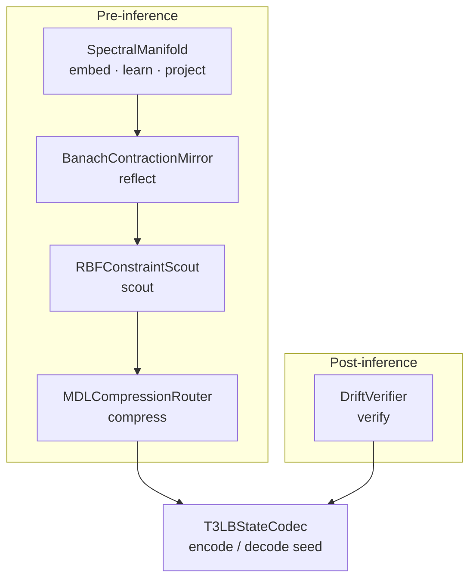

# Mathematical Architecture

Five modules, one pipeline. All computation is CPU linear algebra (`numpy` only).



### 1. `SpectralManifold` (Feature Hashing + Sign-Canonicalized Dual-Gram SVD)
Maps prompts into $\mathbb{R}^{512}$ via signed 32-bit `Blake2b` projections of character 3-grams and word unigrams (with token and prompt LRU caching). Over a sliding trajectory window ($W = 20$, refit every turn for $N \le 10$ and novelty-gated at $\text{residual} > 0.30$ every 10 turns thereafter), it computes the exact **Dual-Gram Singular Value Decomposition** ($G = X_c X_c^T$, recovering $V_k = \Sigma_k^{-1} U_k^T X_c$), extracting the top $k$ orthonormal principal axes $V_k \in \mathbb{R}^{k \times 512}$ with deterministic sign canonicalization ($\max_j |V_k[i, j]| > 0$).
* **Normalized Centered Residual:** Measures exact orthogonal projection loss on the centered vector $v_c = v - \mu$:
  $$\text{reconstruction\_error} = \frac{\|v_c - P_{V_k}(v_c)\|_2}{\|v_c\|_2 + \varepsilon} \in [0.0, 1.0]$$
* **Effective Dimensionality:** Computes the exponential Shannon entropy of the normalized singular value spectrum $e^{H(\sigma^2)}$.

### 2. `BanachContractionMirror` (Fixed-Point Context Alignment)
Models conversational intent alignment as an iterated dynamical system on the unit hypersphere $S^{F-1}$:
$$x_{t+1} = \text{normalize}\Big((1 - L_t) x_t + L_t A(x_t, C)\Big), \quad L_t = \Phi^{-t}$$
where $A(x_t, C)$ is the Boltzmann softmax barycenter over historical memory vectors $C$ ($\text{maxlen} = 32$) and $\Phi = \frac{1+\sqrt{5}}{2}$. Tracks step displacements to compute the **empirical Lyapunov exponent** ($\lambda < 0$), confirming whether the dialogue is converging toward a stable attractor.

### 3. `RBFConstraintScout` (Continuous Friction Field)
Applies a **Radial Basis Function (Gaussian Kernel Density) Estimator** over the $k$-dimensional spectral coordinates ($\text{maxlen} = 64$ nodes), combining prompt quality deficit, centered manifold reconstruction residual, and attractor alignment deficit to flag topological friction walls ($F > \Phi^{-1} \approx 0.618$).

### 4. `DriftVerifier` (Sanctioned Dream vs. Sporadic Risk Router)
Audits post-inference SLM outputs without external RAG by combining semantic drift ($1 - \cos(v_{\text{prompt}}, v_{\text{output}})$), assertive-to-hedging lexical ratios, and unsolicited specificity density (named entities, years, floating-point percentages):
* `SANCTIONED_DREAM`: High novelty explicitly invited when `dreaming=True`.
* `VERIFIED`: Grounded response consistent with prompt manifold.
* `SPORADIC_RISK`: High-specificity confabulation detected when `dreaming=False`.

### 5. `T3LBStateCodec` (13-Dimensional State Seed)
Serializes 13 operational constraint parameters ($X, Y, Z, W, P, T, R, S, V, N, E, B, Q$) into a compact 93-byte string (lossless at 2-decimal fixed precision):
```text
T3LB:v2026.10|M4.11|X0.88Y1.25Z0.76W1.01P0.87T0.79R0.79S0.92V0.78N0.74E0.88B0.79Q0.93|SecLock
```
